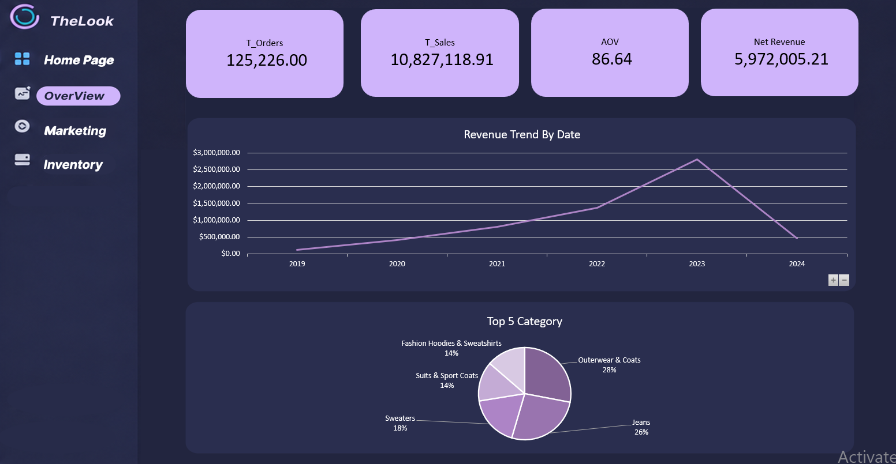
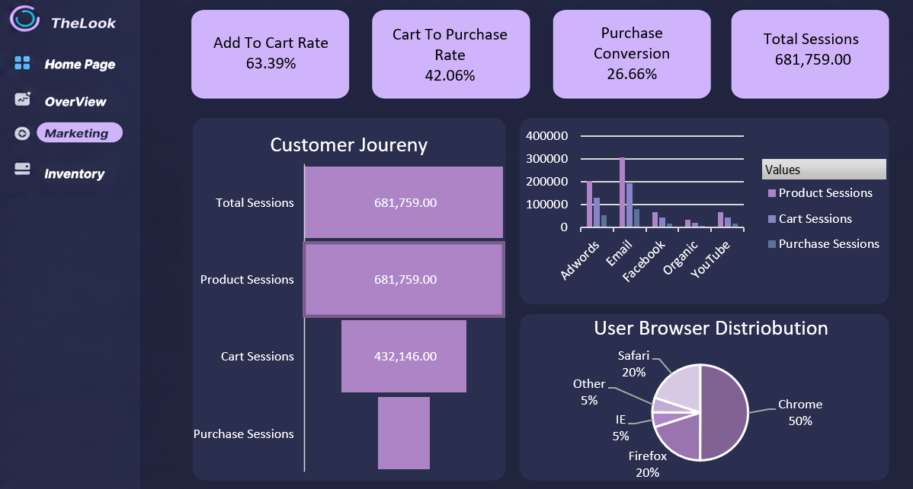
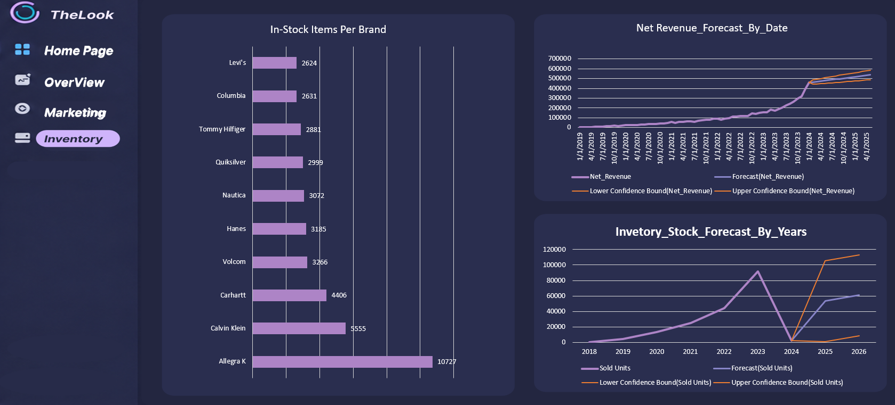

# TheLook — E-Commerce Fashion Analytics

**An Excel-based analytics dashboard exploring fashion e-commerce sales, customer journeys, product performance, inventory, and forecasting.**

## Dashboard preview

### Home Page

### Sales Overview

### Marketing & Customer Journey

### Inventory & Forecasting

## Project overview

This project analyzes an e-commerce fashion dataset using Excel. Power Query is used for data preparation, Power Pivot for the analytical data model and DAX measures, and PivotTables/PivotCharts for reporting. The dashboard uses a custom fashion-inspired visual theme.

| Dashboard page | Main elements |
| --- | --- |
| Home Page | Fashion analytics landing page and navigation |
| Overview | Total orders, sales, average order value (AOV), revenue trends, top product categories |
| Marketing | Shopping funnel, add-to-cart rate, cart-to-purchase rate, purchase conversion, traffic-source breakdown, browser distribution |
| Inventory | In-stock items by brand, revenue forecast, and historical/forecast sold units |

## Key insights

- **Shopping funnel performance:** The dashboard records **681,759 sessions**, including **432,146 cart sessions** and **181,759 purchase sessions**. The displayed **add-to-cart rate is 63.39%**, **cart-to-purchase rate is 42.06%**, and **overall purchase conversion is 26.66%**. These are aggregate, event-based session metrics rather than a verified step-by-step customer journey.
- **Top revenue categories:** Within the **five categories shown in the Top Categories chart**, **Outerwear & Coats (28%)** and **Jeans (26%)** together represent approximately **54% of that top-five revenue mix**. This percentage does not describe their share of all product categories.
- **Sales versus recognized-status revenue:** The reported **Total Sales is approximately $10.83M**, compared with **$5.97M in status-filtered Net Revenue** from `Complete` and `Shipped` order items. The difference reflects differing reporting scopes; it should **not** be interpreted as discounts, refunds, or lost revenue without further analysis.
- **Inventory composition:** The inventory analysis counts **490,705 item records**, with **181,759 marked as sold** and **308,946 without a sold date** (approximately **63%**). This is a dataset-level sold/unsold split, not proof of today's available stock or a historical stock balance.
- **Forecasting limitation:** Historical sales and revenue charts show a sharp change around **2024**. Because the final observed period may be incomplete, forecast outputs are presented as **exploratory** and should be validated before making business decisions.

*All figures above are based on the captured dashboard results and may change with workbook updates, filters, and metric definitions.*

## Tools

- Microsoft Excel
- Power Query (ETL / cleaning)
- Power Pivot and DAX (data modeling / metrics)
- PivotTables and PivotCharts (dashboard reporting)
- Excel Forecast Sheet (exploratory forecasting)
- Figma (visual layout and graphics)

## Data source

**TheLook Ecommerce BigQuery Dataset**, shared on Kaggle:
https://www.kaggle.com/datasets/mustafakeser4/looker-ecommerce-bigquery-dataset

The original CSV source data is not redistributed here. Download it from its source and review its licensing terms before reusing it.

## Metric notes

- **Total Sales**: sales value according to the workbook's chosen reporting measure.
- **Net Revenue**: in this project, the current DAX convention includes order items with status `Complete` or `Shipped`. This is an operational reporting definition, not necessarily accounting net revenue after every refund, discount, and adjustment.
- **AOV**: average order value; the numerator and denominator should use consistent eligible order statuses and filters. Confirm the final measure before treating any screenshot value as definitive.
- **Funnel KPIs**: calculated using distinct event session IDs for the relevant funnel events. They describe recorded events, not necessarily a verified chronological, user-level attribution path.
- **Forecasts**: exploratory Excel-generated forecasts; assess partial periods, seasonality, confidence bounds, and holdout accuracy before drawing planning conclusions.
- **Inventory**: the inventory source records individual inventory items; it is not automatically a historical daily inventory-snapshot table.

## Notes

This repository documents an educational analytics project. The screenshots show the dashboard design at the time they were captured. For current calculations, use the latest workbook after validating measures and data ranges.
